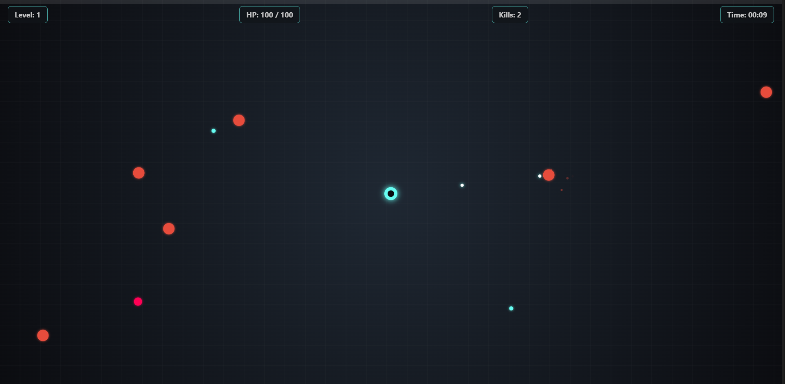

# ⚡ Ragbar (رگبار)


یک بازی اکشن مینیمال در سبک **Reverse Bullet Hell / Horde Survival** که به صورت تک‌فایلی (`Single-File`) و بدون هیچ‌گونه فریم‌ورک یا کتابخانه جانبی پیاده‌سازی شده است.

🎮 **[اجرای آنلاین و تجربه بازی](https://IamMFK.github.io/ragbar/)**

> ✅ **کراس‌پلتفرم و ریسپانسیو:** این بازی هم روی **دسکتاپ (Desktop)** و هم روی **موبایل و تبلت (Mobile & Tablet)** به‌صورت کامل اجرا می‌شود. روی دستگاه‌های لمسی، یک **جوی‌استیک مجازی شناور (Floating Virtual Touch Joystick)** برای حرکت روان فعال می‌شود و تمام بخش‌های بازی با لمس کار می‌کنند.

### 🖼️ پیش‌نمایش بازی

<p align="center">
  
</p>

## 🕹️ گیم‌پلی و مکانیک‌ها

* **شلیک ممتد و هدف‌گیری هوشمند:** سیستم هدف‌گیری خودکار به سمت نزدیک‌ترین تهدید با قابلیت ارتقای نرخ آتش، دمیج، تعداد پرتابه‌ها و نفوذ در اهداف.
* **حلقه پیشرفت و بیلدسازی:** جمع‌آوری کریستال‌های XP حاصل از نابودی دشمنان، ارتقای **سطح بازیکن (Player Level)** و گزینش استراتژیک از بین ۳ مهارت رندوم.
* **جواهرات XP با عمر محدود:** کریستال‌های XP تا **۱۵ ثانیه** روی زمین باقی می‌مانند و پس از آن بدون هیچ ردی محو می‌شوند؛ پس حرکت به سمت آن‌ها و مدیریت ریسک، بخشی از استراتژی بازی است.
* **تنوع دشمنان مبتنی بر سطح بازیکن:** هرچه سطح بازیکن (Player Level) بالاتر برود، انواع قوی‌تر و خطرناک‌تر دشمن وارد میدان می‌شوند (جدول پایین 👇).
* **جلوه‌های صوتی پروسیجرال:** شبیه‌سازی کامل افکت‌های صوتی (شلیک، انفجار، الماس و ارتقا) در لحظه با استفاده از **Web Audio API** بدون نیاز به فایل‌های صوتی خارجی.
* **رندر گرافیکی سبک و روان:** اجرای پایدار ۶۰ فریم بر ثانیه مبتنی بر Canvas با افکت‌های نوری و سیستم ذرات (Particle System) و **Object Pooling** برای کاهش فشار روی Garbage Collector.

## 🎯 سیستم پیشرفت: فقط سطح بازیکن (Player Level)


* با جمع‌آوری کریستال‌های XP، سطح بازیکن افزایش می‌یابد (نیاز XP هر لول ×۱.۴۵).
* ارتقای سطح، مودال انتخاب مهارت را باز می‌کند و بیلد شما را شکل می‌دهد.
* ترکیب و ورود دشمنان جدید به استخر اسپاون نیز مستقیماً به **سطح بازیکن** وابسته است — یعنی هرچه قوی‌تر شوید، دنیا هم سخت‌تر می‌شود.

| سطح بازیکن (Player Level) | رخداد |
| :---: | :--- |
| **Level 1+** | شروع بازی با دشمنان معمولی |
| **Level 3+** | ورود دشمنان سریع (Fast) به میدان |
| **Level 8+** | ورود دشمنان تانک (Tank) به میدان |

## 👾 انواع دشمنان

| دشمن | سرعت | جان (HP) | دمیج | XP | شرط حضور |
| :--- | :---: | :---: | :---: | :---: | :--- |
| 🔴 **معمولی (Normal)** | ۱.۳ | ۵۰ | ۱۲ | ۱ | از **Level 1** |
| 🩷 **سریع (Fast)** | ۲.۴ | ۲۰ | ۸ | ۲ | از **Level 3** |
| 🟣 **تانک (Tank)** | ۰.۸ | ۱۵۰ | ۲۰ | ۵ | از **Level 8** |

> هیچ دشمن تیراندازی وجود ندارد؛ تمام دشمنان با حرکت و تعقیب تهدید ایجاد می‌کنند.

## 🎮 کنترل‌ها

### 💻 دسکتاپ (Desktop)

| عمل | کنترل |
| :--- | :--- |
| **حرکت** | کلیدهای `W, A, S, D` یا کلیدهای جهت‌نما |
| **انتخاب ارتقا** | کلیک ماوس روی کارت مهارت |
| **شروع مجدد** | کلیک روی دکمه Restart |

### 📱 موبایل و لمسی (Mobile / Touch)

| عمل | کنترل |
| :--- | :--- |
| **حرکت** | جوی‌استیک مجازی شناور (Floating Virtual Touch Joystick) — هر نقطه‌ای از صفحه که لمس کنید، جوی‌استیک همان‌جا ظاهر می‌شود |
| **انتخاب ارتقا / شروع مجدد** | لمس (Tap) روی کارت مهارت یا دکمه‌ها |

## 🛠️ تکنولوژی‌ها

* **HTML5 Canvas API:** رسم بلادرنگ المان‌های بازی، حلقه‌های نوری و ذرات
* **Vanilla JavaScript (ES6+):** معماری برداری، حلقه بازی (`requestAnimationFrame`)، تشخیص برخورد و Object Pooling
* **Web Audio API:** سینت سایزر نرم‌افزاری برای تولید افکت‌های صوتی ریل‌تایم
* **Touch Events API:** پیاده‌سازی جوی‌استیک مجازی شناور و پشتیبانی کامل لمسی
* **CSS3:** رابط کاربری شیشه‌ای (Glassmorphic HUD) و طراحی ریسپانسیو برای موبایل و دسکتاپ

## 🚀 اجرای لوکال

برای اجرای بازی نیاز به هیچ بیلدتول، پکیج منیجر یا سروری نیست.

کافیست فایل `index.html` را در هر مرورگری (دسکتاپ یا موبایل) اجرا کنید یا ریپازیتوری را کلون نمایید:

```bash
git clone https://github.com/IamMFK/ragbar.git
# سپس index.html را در مرورگر باز کنید
```

